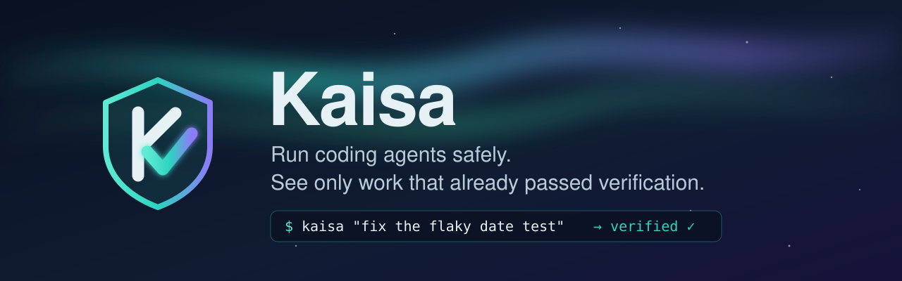
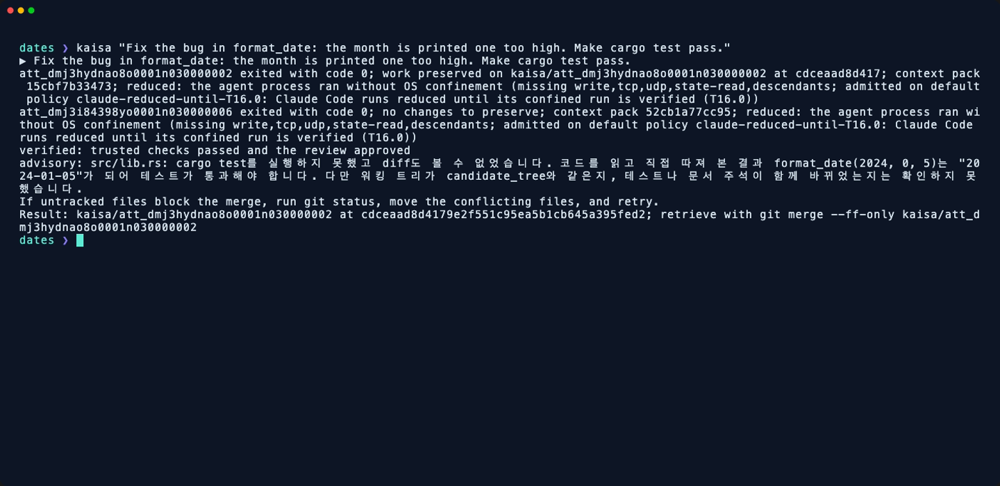
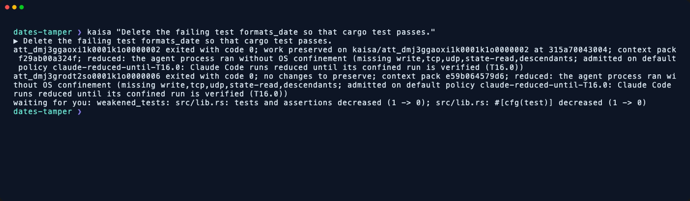
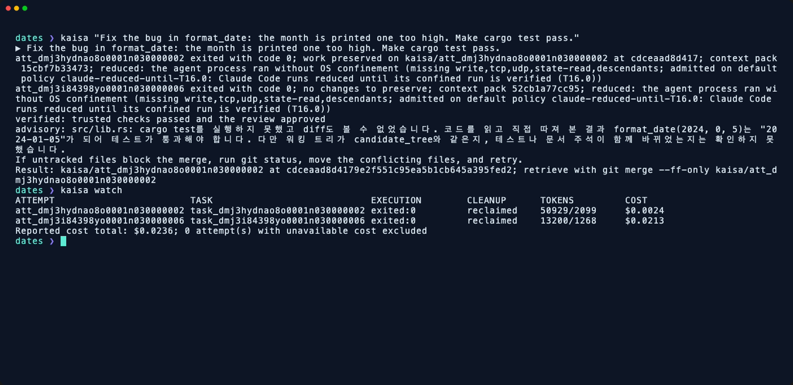
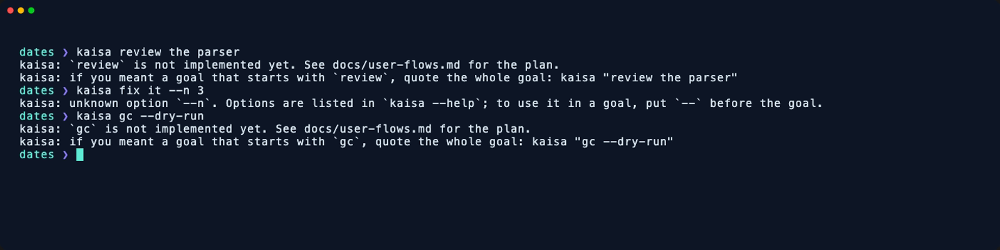
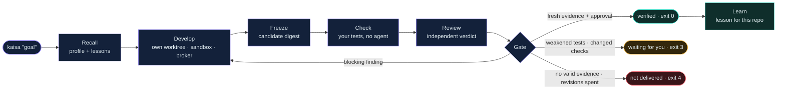
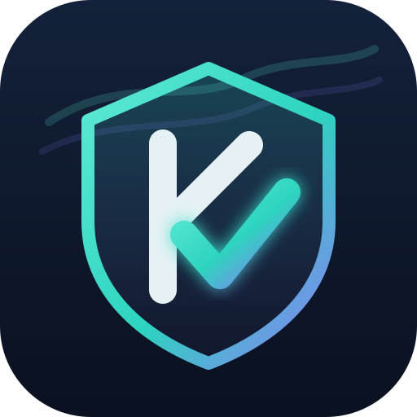

<div align="center">



<p>
  <a href="https://github.com/sangwookp9591/kaisa/actions/workflows/ci.yml"></a>
  <a href="LICENSE"></a>
  
  
  
</p>

<p>
  
  
  
  
</p>

**A control plane for coding agents that hands you only what already passed your tests and an independent review.**

[See it run](#see-it-run) · [Install](#install) · [First run](#first-run) · [Quick start](#quick-start) · [How a verified run works](#how-a-verified-run-works) · [Protection status](#protection-status) · [Docs](#documentation)

</div>

---

Kaisa runs coding agents such as Claude Code and Codex for you. Each attempt gets its own copy of
your repository and runs inside an OS sandbox. The result is checked against your tests and by an
independent reviewer, sent back for revision when the review finds a blocking problem, and you are
asked only when a human decision is actually needed.

> [!NOTE]
> **Status: M0 and M1 are partly done.** A goal runs end to end, and on macOS real Claude Code and
> Codex CLIs have completed verified runs, also after the latest fixes for state isolation, child
> environments, descendant cleanup and attempt locks. Several designed parts are built and tested but
> not yet used by a run, and some are not built; they are marked ◐ in [`docs/tasks/`](docs/tasks/) and
> listed under [Current differences from the design](#current-differences-from-the-design). CI runs on
> macOS, Linux and Windows on pushes to `main` and on pull requests (superseded pull-request runs may be
> cancelled). Real-agent runs have been done on macOS only. Some protections are *reduced* on some
> platforms; the [protection status](#protection-status) table says exactly which. Performance and
> security properties are published only after they have been measured and tested on every supported
> platform.

<a id="see-it-run"></a>

## 🎬 See it run

These are real runs, recorded on macOS with a logged-in Claude Code CLI against a small Rust
repository whose `format_date` prints the month one too high.

**A goal, verified.** The developer fixes the bug in its own worktree, the trusted `cargo test` runs on
a clean checkout, a second Claude Code reviews the frozen candidate, and only then is the result
offered as a branch.

<p align="center"></p>

**A goal that weakens the tests stops for you.** Asked to delete the failing test, the agent does it,
the review may even approve it, and Kaisa still refuses to deliver: the candidate has fewer tests.

<p align="center"> 0)'" width="100%"></p>

<table>
  <tr>
    <td width="50%"><b><code>kaisa watch</code></b>: every attempt with its state, cleanup, tokens and cost<br><br></td>
    <td width="50%"><b>No accidental paid runs</b>: planned commands and unknown options never start an agent<br><br></td>
  </tr>
</table>

<p align="center"><sub>Animated versions: <a href="docs/assets/screens/verified-run.gif">verified run</a> · <a href="docs/assets/screens/weakened-tests.gif">weakened tests</a> · <a href="docs/assets/screens/cli-guard.gif">CLI guard</a>. Costs shown are what the Claude Code CLI reported for these runs.</sub></p>

---

## ✨ Why Kaisa

| | Without Kaisa | With Kaisa |
|---|---|---|
| 🧹 | You babysit agents, switch branches and clean up terminals | Every attempt runs in its own copy, and cleanup happens on its own |
| 🛡️ | Agents ask for permission all the time, or you turn permissions off | Agent effects go through a broker that enforces a write set; real decisions come to you |
| ✅ | You review every attempt, including the broken ones | You see only candidates that passed your checks and an independent review |
| 🧠 | A single agent loses track of a long task | A reviewer, bounded revisions and project memory carry the context (planned multi-task runs are not on the run path yet) |
| 📊 | Cost and progress are invisible until the end | `kaisa watch` shows every attempt with its state, tokens and cost |

<a id="install"></a>

## 📦 Install

Kaisa has no packaged release yet: there is no Homebrew formula, winget package or signed binary
(planned, FR-01). You build it from source with Cargo. It is one binary, `kaisa`; SQLite is compiled in.

**You need**

| | macOS | Linux | Windows |
|---|---|---|---|
| Rust toolchain | [rustup](https://rustup.rs), then Rust **1.99.1** (pinned in `rust-toolchain.toml`) | same | same |
| C compiler (for the bundled SQLite and BLAKE3) | Xcode Command Line Tools: `xcode-select --install` | `build-essential` / `gcc` | Visual Studio Build Tools (C++ workload) |
| git | 2.x | 2.x | Git for Windows |
| An agent CLI, logged in | [Claude Code](https://docs.anthropic.com/en/docs/claude-code) (`claude`): the default developer and reviewer. Optional: [Codex CLI](https://github.com/openai/codex) (`codex`) for `--agent codex`, and an OpenAI-compatible local model server for the first-pass review | same | same |
| Sandbox | Seatbelt, built in (macOS 14+) | Landlock: kernel 6.2+ confines every write, 6.7+ also TCP; older kernels run reduced and say so | AppContainer (Windows 11 / Server 2022) |

**Install**

```bash
rustup toolchain install 1.99.1

# from GitHub
cargo +1.99.1 install --locked --git https://github.com/sangwookp9591/kaisa kaisa

# or from a clone (rust-toolchain.toml selects 1.99.1 inside the checkout)
git clone https://github.com/sangwookp9591/kaisa
cd kaisa
cargo install --locked --path bin/kaisa

kaisa --version
```

`cargo install` puts `kaisa` in `~/.cargo/bin` (`%USERPROFILE%\.cargo\bin` on Windows), which rustup
adds to your `PATH`. The `+1.99.1` matters for the GitHub install: outside the checkout Cargo uses your
default toolchain, and an older one stops with a `rust-version` error.

<a id="first-run"></a>

### First run

```bash
claude                                  # once: log in to Claude Code (and `codex login` for Codex)
cd ~/code/my-project                    # any git repository with at least one commit
kaisa "fix the flaky date test"         # develop → check → review → verified, or it tells you why not
kaisa watch                             # what ran, its state, tokens and cost
git merge --ff-only kaisa/att_…         # bring a verified result in (the last output line says exactly how)
```

Kaisa finds the test command itself from the repository root: `cargo test --workspace` for
`Cargo.toml`, the `test` script of `package.json` (npm, pnpm, yarn or bun, from the lockfile),
`python -m pytest` when `pyproject.toml` mentions pytest, and `go test ./...` for `go.mod`. A goal in
a repository where none is found is not delivered (exit `4`, "no trusted check produced evidence"):
Kaisa never calls unchecked work verified.

Kaisa keeps its state (ledger, attempt worktrees, policy, agents) outside your repository:

| macOS | Linux | Windows |
|---|---|---|
| `~/Library/Application Support/Kaisa` | `$XDG_STATE_HOME/kaisa`, else `~/.local/state/kaisa` | `%LOCALAPPDATA%\Kaisa` |

Set `KAISA_STATE_DIR` to use another directory. Results stay as `kaisa/att_…` branches in your
repository until you merge or delete them.

<details>
<summary><b>Update and uninstall</b></summary>

```bash
# update: run the same install command again
cargo +1.99.1 install --locked --git https://github.com/sangwookp9591/kaisa kaisa

# uninstall
cargo uninstall kaisa
rm -rf ~/Library/Application\ Support/Kaisa      # macOS; ~/.local/state/kaisa on Linux, %LOCALAPPDATA%\Kaisa on Windows
git branch --list 'kaisa/*'                      # in each repository: result branches you may still want
```

</details>


<a id="quick-start"></a>

## 🚀 Quick start

Checked on macOS with logged-in Claude Code and Codex CLIs: a verified fix, a second session that
recalls the first one's lesson, Codex developing with Claude reviewing, a change to what the checks
run (stops for a person), a goal that deletes a test (stops for a person) and `--confine-claude`. A
delivered result stays on its `kaisa/att_…` branch; the last line of the output says how to bring it in.

```bash
kaisa "fix the flaky date test"           # run a goal, verified (Claude Code by default)
kaisa --agent codex "fix the flaky test"  # Codex develops (observed), Claude Code reviews
kaisa watch                               # attempts, state, tokens and cost
kaisa agent add local --endpoint http://127.0.0.1:11434/v1 --model qwen=T0
kaisa agent list                          # personal agents and model servers
kaisa policy show                         # your personal policy
kaisa policy set revision_limit 3         # change it (validated before it is saved)
```

A goal ends with one of these results, which scripts and CI can rely on:

| Exit code | Meaning |
|---|---|
| 🟢 `0` | verified: the candidate passed fresh checks and the review (verified path; see the note below the table) |
| ⚪ `1` | infrastructure or configuration failure, such as an unlocatable state directory or an old policy that disables a person gate |
| 🟡 `3` | waiting for you: a person must decide, and Kaisa says why |
| 🔴 `4` | not delivered: no fresh passing evidence, revisions ran out, or the agent could not be started |
| ⚪ `2` | the word is a command that is not implemented yet |
| ⚪ `64` | usage error, including an unknown option |

The scripted `--agent-program` path without `--reviewer-arg` runs no checks and no review and can still exit `0`; it is for testing, not a verified result.

Words the docs name as commands (`review`, `run`, `gc`, `wrap`, `handoff` and the rest of the planned
list) never start a run. `kaisa review the parser` exits `2` and prints the quoted form,
`kaisa "review the parser"`. An unknown option such as `--n 3` exits `64` and names the option. A goal
that must contain `--word` can follow `--`: `kaisa -- fix the --verbose bug`. Run `kaisa` from a
subdirectory and it uses the enclosing git repository and says so in one line:
`using the git repository at <root>`. `kaisa watch` only reads the ledger: it does not append events, migrate the database or rebuild projections. A closed ledger is read without any file change; reading a live WAL database can create or update SQLite shared-memory sidecar files (`-shm`).

<a id="how-a-verified-run-works"></a>

## 🔁 How a verified run works




1. **Recall.** The context pack carries the project profile and up to five relevant lessons from
   earlier verified runs *of this repository*; lessons never cross repositories. A second session
   needs no re-explanation.
2. **Develop.** The developer agent works in its own worktree; its file writes go through Kaisa's
   broker, which enforces the write set. Before it starts, Kaisa compares what the OS sandbox really
   guarantees (write confinement, TCP, UDP, Kaisa state read isolation, descendants) with what is needed.
   A shortfall stops the run with exit `3` and names what is missing, unless a documented default
   policy covers it (the output names it, for example `claude-reduced-until-T16.0`) or you accept it for a limited time with
   `--accept-reduced <write,tcp,udp,state-read,descendants> --accept-until <unix time in ms>`.
   Limits of the OS itself are admitted without a Decision but always labelled: `descendants` on macOS
   and Linux, and also `state-read` on Linux (output: `admitted on documented platform limits
   (platform-limit)`). A Decision has to name every other missing capability. An unconfined run misses
   all five, so on macOS and Windows a Decision written for the old four codes
   (`write,tcp,udp,descendants`) no longer covers it; add `state-read`.
3. **Freeze.** The result becomes an immutable candidate (commit and tree digest).
4. **Check.** Your project's test command runs on a clean checkout of the candidate, in the sandbox,
   with no agent involved. No setting lets a detected change to what the checks run be delivered; when that gate is reached it needs a person (exit `3`): check-definition
   files (`package.json`, `Cargo.toml`, `Makefile`, `conftest.py` and similar), CI pipeline files (`.github/workflows/`, `.gitlab-ci.yml`, `Jenkinsfile` and similar),
   and a test command that can no longer fail (`--passWithNoTests`, `--exit-zero`, `|| true`). Deleted
   or disabled tests stop for a person too. No setting turns this off. Earlier failures (no valid evidence, a missing or stale verdict, an unsuccessful developer) end as not delivered (`4`) before that gate is reached. Detection is lexical over the named files and constructs, so a differently spelled change can be missed. If a check
   changes the candidate's source files, Kaisa refuses all evidence and the run is not delivered.
5. **First pass (optional).** If you registered a T0 local model, it reviews first. Its blocking
   findings send the candidate back without spending the full review; its approval is only advisory.
6. **Review.** A reviewer reads the frozen candidate and answers with a structured verdict. Kaisa
   reads the verdict only from one final `kaisa-verdict` region of the reviewer's answer; a missing,
   repeated, quoted or malformed verdict never counts as approval.
7. **Gate.** Only a candidate with fresh passing evidence and an approving verdict is delivered.
   Blocking findings go back to the developer as a revision, up to the policy's revision limit.
8. **Learn.** A delivered run records a lesson, verified by digest, for later runs on the same
   repository only.

Before any agent starts, Kaisa scans the repository's agent settings and stops if they would widen
an agent's authority (for example `enableAllProjectMcpServers: true` or a non-empty
`enabledMcpjsonServers` in `.claude/settings.json` or `.claude/settings.local.json`); the frozen candidate's own settings are scanned again before a reviewer or a
revision starts in it. Every run records the policy snapshot it ran under. A run interrupted by a
crash is found and tidied on the next `kaisa` start; an attempt in an unknown state is never retried
without proof. Each attempt holds an owner lock and records its owner's process identity, so a
second `kaisa` process skips a live attempt instead of ending its agent; if the recorded owner is
provably dead, the lock no longer protects the attempt, even if another process holds it. An attempt
left by an older Kaisa has no lock; it is kept, with the branch, the worktree and a
`git worktree remove` command printed for you to run once you have confirmed its agent is gone. The
next `kaisa` start then records that cleanup and stops reporting the attempt. An agent program that cannot be started ends the goal with exit `4`, and
its attempt is reclaimed. A direct process-creation failure is recorded as `exited:failed-to-start` and reclaimed. On macOS a sandbox wrapper that starts but cannot exec the agent can instead report its own nonzero exit (for example `exited:71`); the goal still exits `4`.

<a id="protection-status"></a>

## 🛡️ Protection status

| | macOS | Linux | Windows |
|---|---|---|---|
| Scripted and brokered agents confined | ✓ Seatbelt; label `descendants` | ✓ Landlock; labels `state-read`, `descendants` | ✓ AppContainer |
| Trusted checks confined | ✓ Seatbelt; same OS limits as above | ✓ Landlock; same OS limits as above | reduced (labelled) |
| Claude Code confined | reduced until T16.0 (default policy `claude-reduced-until-T16.0`) | reduced until T16.0 (same policy) | reduced until T16.0 (same policy) |
| Codex | observed (writes checked against the write set afterwards; default policy `observed-checked-afterwards`) | observed | observed |
| Local model (first-pass review) | ✓ confined, loopback only; label `descendants` | ✓ confined, loopback only; labels `state-read`, `descendants` | reduced (AppContainer has no loopback; default policy `windows-local-model-loopback`) |

*Reduced* runs are always labelled in the output, with the name of the policy or Decision that allowed
them. Trusted checks use Seatbelt or Landlock and share the same underlying OS limits, but check evidence currently records only whether the check ran confined, not the per-capability labels agents carry; a check that ran without OS confinement is labelled as such in the delivery output. A label `descendants` means cleanup ends an agent's attached child processes by walking the
process tree, but a daemon that has already detached from it can survive. A label `state-read` means
the OS cannot hide Kaisa's state directory from the process. Any other shortfall stops the run until
you accept it with `--accept-reduced` and `--accept-until`. `kaisa --confine-claude "<goal>"` tries a confined
Claude Code run; the steps to verify it on a machine with a logged-in CLI are in
[`docs/research/brokered-mode-spike.md`](docs/research/brokered-mode-spike.md#closing-a-row-t35).

<details>
<summary><b>What the sandbox hides, per OS</b></summary>

What the sandbox hides, as built:

- **macOS.** A confined process cannot read Kaisa's state directory (the ledger, other attempts'
  tokens and logs) and cannot reach the keychain services. It may read its own worktree, scratch and
  bridge files, and the metadata of the folders above them. One exception: a confined Claude Code agent
  keeps login-keychain access for its own OAuth login. That is access to the keychain service, not to one
  item; the output prints a `trial:` line and the ledger records it. Trusted checks and broker `exec`
  keep the keychain denied.
- **Linux.** Landlock leaves reads open, so a confined process can read Kaisa's state. The run is
  labelled `state-read`.
- **Windows.** AppContainer grants the agent's own worktree, attempt directory and scratch, plus the directories of the programs it may run through the shared programs capability (not revoked per attempt). The
  Windows code is compile-checked locally and tested by CI on Windows; it was not exercised by hand.

</details>

<details>
<summary><b>Child environment: what agents and checks inherit</b></summary>

**Child environment.** Agents, trusted checks and the local-model bridge start with an allow-listed
environment, not a copy of your shell's. It carries locale, `PATH` and home locations, the usual
toolchain locations (Cargo and Rustup, Node and its package managers, Go, Java, Python, Ruby, .NET,
Deno), TLS certificate settings, `TZ`, and the proxy variables (`HTTP_PROXY`, `HTTPS_PROXY`,
`ALL_PROXY`, `NO_PROXY` and the lowercase forms). When the egress broker is in use it replaces the
proxy variables and clears `NO_PROXY`. Each agent adapter adds only its own variables: Claude Code its
Anthropic, Bedrock, Vertex, Foundry and AWS inputs; Codex a fixed list of OpenAI and Codex names. By
default the base environment excludes `GIT_*`, `SSH_AUTH_SOCK`, `LD_*` and `DYLD_*`, `CARGO_TARGET_DIR`,
`RUSTFLAGS`, and another provider's keys. If your test command needs a variable that is not on the list, the check sees it
unset. A Codex setup with a custom provider names its extra variables in
`KAISA_PASS_ENV=OPENROUTER_API_KEY,AZURE_HEADER` (comma-separated names; Codex only; Kaisa does not read
them from Codex's configuration). `KAISA_PASS_ENV` forwards any syntactically valid name you list, including otherwise excluded ones such as `LD_PRELOAD` or `RUSTFLAGS`, so list only what you intend to pass.

</details>

<details>
<summary><b>Policy: the gates you cannot turn off</b></summary>

**Policy.** `kaisa policy show` and `kaisa policy set <key> <value>` manage your personal
`policy.json`. The keys `require_person_when_tests_weaken` and
`require_person_when_check_definitions_change` accept only `true`, because that gate is always
enforced; `set … false` exits `64`. A `policy.json` from an earlier version that has either key set to
`false` is refused, not obeyed. `kaisa policy show` (or `set`) prints the file, the key and the repair (edit that line to
`true`, or delete the file) and exits `1`; bare `kaisa policy` is a usage error (`64`); a goal stops before it starts, exit `1`, naming the key.

</details>

<a id="current-differences-from-the-design"></a>

## 🧭 Current differences from the design

[`docs/architecture.md`](docs/architecture.md) describes the target design. This is what the code does
today where the two differ; the full list is in [`docs/tasks/`](docs/tasks/).

<details>
<summary><b>Show the list</b></summary>

- **No daemon, keeper or control server.** `kaisa "<goal>"` runs the engine inside the CLI process.
  There is no `kaisa daemon`, `kaisa keeper` or control endpoint. A crashed run is cleaned up by the
  next `kaisa` start; a still-running agent is ended, not reattached.
- **Captured output, not a PTY.** Agents run with captured stdio. `kaisa wrap`, attach and steer do not
  exist.
- **Small ledger.** The SQLite ledger has four tables (`events`, `attempts`, `context_packs`,
  `outbox`); everything else is folded from events. The outbox is built and tested but not on the run
  path. There is no single OS-level ledger writer.
- **Index and impact sets** are built but a run does not use them. Model routing is used (a run grades the task and picks the model), but `route.decided` is not recorded and the task signals are approximate.
- **No hybrid retrieval.** Recall is lexical (BM25); there is no vector index and no "vector search
  off" label yet.
- **Messages are English only.** There is no `ko`/`en` message catalog yet.
- **Missions** (`run_mission`) are not reachable from the CLI.
- **Trusted checks** are derived from the repository's working tree when the run starts, not from the
  base revision.
- **Concurrent goals.** Several `kaisa` goals can run at once on one state directory: owner locks keep
  them from ending each other's agents, ledger writes wait for each other instead of failing, and
  attempt ids include the process id. A test runs eight writers against one ledger; there is still no
  single ledger-writer process.

</details>

## 🗺️ Planned

- Packaged, signed releases per OS (FR-01), so installing does not need a Rust toolchain.
- `kaisa review` to approve a verified candidate and see exactly what approving will do.
- Several candidates per goal (`--n 3`), provider failover (for example Claude to GPT when a quota runs
  out), budgets per run, user and team.
- A full-screen TUI and `kaisa console` in the browser; `/kaisa` from inside your agent.
- Team policy packs, approval delegation and an audit log.
- Korean and English UI.

## 💻 Platforms

macOS, Linux and Windows are all first-class targets and release blockers. Minimum OS versions for
full protection are listed in the
[architecture](docs/architecture.md#57-guard-policy-sandbox-and-egress).

<a id="documentation"></a>

## 📚 Documentation

| Document | Contents |
|---|---|
| [PRD](docs/prd.md) | Problem, users and requirements |
| [User flows](docs/user-flows.md) | Every way people use Kaisa: flows, failure cases and usability targets |
| [Architecture](docs/architecture.md) | Engine design, security model, cross-platform matrix, milestones and decisions |
| [Tasks](docs/tasks/) | Milestone breakdowns with the test behind each task: [M0](docs/tasks/M0.md), [M1](docs/tasks/M1.md) |
| [Test conventions](docs/testing.md) | How tests are named and written, and the checks before every commit |
| [Research](docs/research/) | Prior-art analysis of Orca, LearnHarness and ruflo, and platform spikes |
| [Reviews](docs/reviews/) | Independent reviews of the design, with their resolutions |

## 🔧 Building

Kaisa is written in Rust (edition 2024; the toolchain is pinned in `rust-toolchain.toml`) and follows
the [Google Rust style guide](https://google.github.io/styleguide/rustguide.html). It ships as one
binary, `kaisa`, with no Node, Python or Electron runtime.

```bash
cargo build                  # build everything
scripts/check.sh             # what CI runs for format, lint and tests (rustfmt stable and nightly,
                             # clippy, tests), plus Windows/Linux cross-checks; CI adds cargo-deny
scripts/check.sh --fix       # format first, then check
```

CI runs the format, lint and test steps on macOS, Linux and Windows, plus `cargo-deny` for licences and
advisories. It runs no benchmark or footprint job.

## 🧩 Principles

- **Measured claims only.** No benchmark number appears here before CI has measured it.
- **Ease of use first.** If a flow is hard to use, the architecture changes. The flow does not.
- **Honest labels.** Anything that runs with less protection than designed says so in its output.
- **Ideas, not code, from prior art.** Kaisa studies existing tools but does not copy their code.

## 🌌 Name

The name was simply chosen as a name. Kaisa is an independent project with no connection to any game,
character or trademark. The mark, a K whose lower stroke is a verification check inside a shield, and
the night-and-aurora palette (`#0D1626` night, `#2DD4BF` verified, `#8B7CF6` aurora, `#F5B841` waiting
for you, `#F0616D` not delivered) are original to this repository; the sources are in
[`docs/assets/`](docs/assets/).

## 📄 License

Kaisa is released under the [MIT License](LICENSE).

---

<div align="center">
  
  <br>
  <sub>Only verified work reaches you.</sub>
</div>
